I build AI agents that read data, call tools and make changes inside a system, with a person approving the steps that matter. Most of my time goes into the parts around the model: the tools it can use, the rules it has to follow, and the checks that show what it actually did.

<a href="https://github.com/brkakyldz/Hotel_Operations_Agent"><picture><source media="(max-width: 600px)" srcset="assets/sea-card-hotel-narrow.svg"></picture></a> <a href="https://github.com/brkakyldz/llm-experiments"><picture><source media="(max-width: 600px)" srcset="assets/sea-card-experiments-narrow.svg"></picture></a>
<a href="https://github.com/brkakyldz/second-brain-os"><picture><source media="(max-width: 600px)" srcset="assets/sea-card-brain-narrow.svg"></picture></a> <a href="https://github.com/brkakyldz/ai-research-agent"><picture><source media="(max-width: 600px)" srcset="assets/sea-card-digest-narrow.svg"></picture></a>

Smaller builds: [GitHub Issue Triage Agent](https://github.com/brkakyldz/github-issue-triage-agent) · [Support Ticket Router](https://github.com/brkakyldz/support-ticket-router) · [Salon Booking Agent](https://github.com/brkakyldz/salon-booking-agent) · [TechInves](https://github.com/brkakyldz/tech_inves)

<picture><source media="(max-width: 600px)" srcset="assets/sea-stack-narrow.svg"></picture>

<a href="https://brkakyldz.github.io/">Portfolio</a> · <a href="https://www.linkedin.com/in/berkeakyildiz/">LinkedIn</a> · <a href="mailto:berkeakyildz@gmail.com">berkeakyildz@gmail.com</a>

