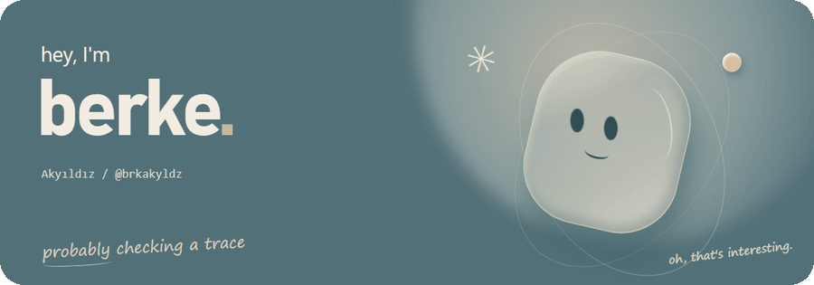
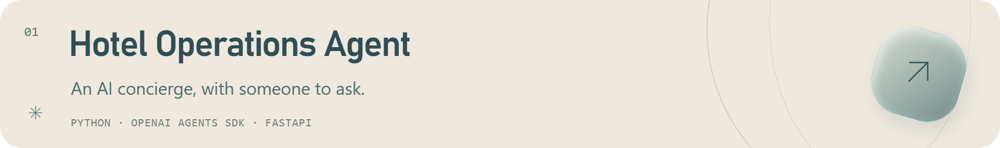
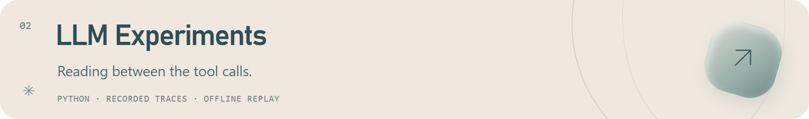
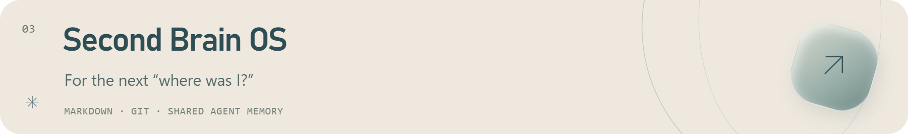
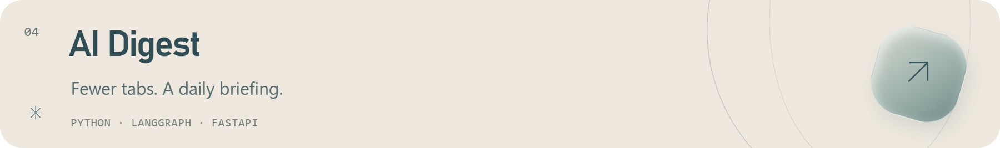

<picture>
  <source media="(prefers-reduced-motion: reduce) and (max-width: 600px)" srcset="assets/profile/hello-mobile.png">
  <source media="(prefers-reduced-motion: reduce)" srcset="assets/profile/hello.png">
  <source media="(max-width: 600px)" srcset="assets/profile/hello-mobile.gif">
  
</picture>

I build AI agents and tools for my own research and notes. I like figuring out which tools an agent needs, what it should remember, and how to check what it actually did.

[Portfolio ↗](https://brkakyldz.github.io/) · [LinkedIn ↗](https://www.linkedin.com/in/berkeakyildiz/) · [Say hello ↗](mailto:berkeakyildz@gmail.com)

### A few things I've built

<a href="https://github.com/brkakyldz/Hotel_Operations_Agent">
  <picture>
    <source media="(max-width: 600px)" srcset="assets/profile/hotel-mobile.png">
    
  </picture>
</a>

An AI concierge for a simulated hotel. It handles guest requests through typed tools, follows business rules in code, and asks a manager to approve restricted actions.

<a href="https://github.com/brkakyldz/llm-experiments">
  <picture>
    <source media="(max-width: 600px)" srcset="assets/profile/experiments-mobile.png">
    
  </picture>
</a>

An experiment on the gap between an agent’s final reply and its tool calls. Recorded traces and offline replay let me inspect what a reply-only evaluation missed.

<a href="https://github.com/brkakyldz/second-brain-os">
  <picture>
    <source media="(max-width: 600px)" srcset="assets/profile/brain-mobile.png">
    
  </picture>
</a>

Shared memory for coding agents, stored in Markdown and versioned with Git. I built it so the next session can pick up the context without starting over.

<a href="https://github.com/brkakyldz/ai-research-agent">
  <picture>
    <source media="(max-width: 600px)" srcset="assets/profile/digest-mobile.png">
    
  </picture>
</a>

A local pipeline that collects AI news, removes duplicates, and turns it into a ranked daily briefing.

### Usually working with

**Python & TypeScript** · FastAPI · Pydantic 
**Agents & integrations** · OpenAI Agents SDK · LangGraph · LangChain · MCP 
**Testing & workflow** · pytest · LangSmith · Git · Docker
