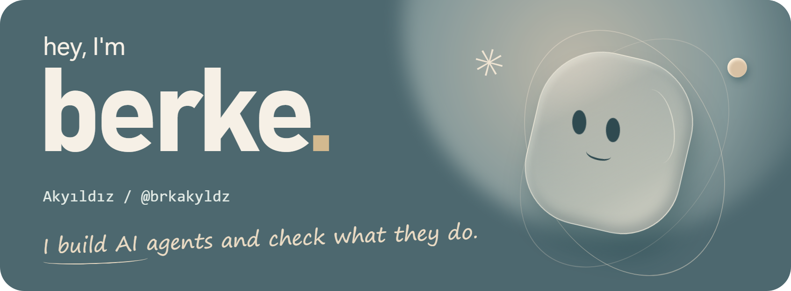
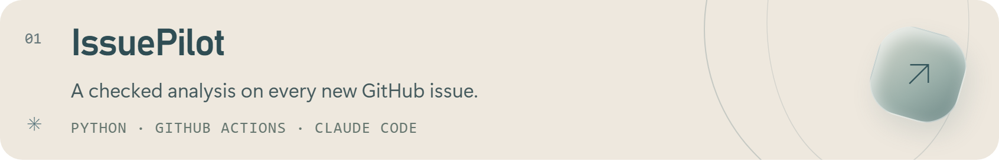

<picture>
  <source media="(prefers-reduced-motion: reduce) and (max-width: 600px)" srcset="assets/profile/hello-mobile.png">
  <source media="(prefers-reduced-motion: reduce)" srcset="assets/profile/hello.png">
  <source media="(max-width: 600px)" srcset="assets/profile/hello-mobile.webp">
  
</picture>

I build LLM agents and the systems around them: tool use, memory, evaluation and tracing, from a first prototype to something that runs and can be tested.

[Portfolio ↗](https://brkakyldz.github.io/) · [LinkedIn ↗](https://www.linkedin.com/in/berkeakyildiz/) · [Say hello ↗](mailto:berkeakyildz@gmail.com)

### A few things I've built

<a href="https://github.com/brkakyldz/IssuePilot">
  <picture>
    <source media="(max-width: 600px)" srcset="assets/profile/issuepilot-mobile.png">
    
  </picture>
</a>

<a href="https://github.com/brkakyldz/second-brain-os">
  <picture>
    <source media="(max-width: 600px)" srcset="assets/profile/brain-mobile.png">
    
  </picture>
</a>

<a href="https://github.com/brkakyldz/Hotel_Operations_Agent">
  <picture>
    <source media="(max-width: 600px)" srcset="assets/profile/hotel-mobile.png">
    
  </picture>
</a>

<a href="https://github.com/brkakyldz/ai-research-agent">
  <picture>
    <source media="(max-width: 600px)" srcset="assets/profile/digest-mobile.png">
    
  </picture>
</a>

Also: [LLM Experiments](https://github.com/brkakyldz/llm-experiments) · [Architecture Drawer](https://github.com/brkakyldz/ArchDrawer) · [Salon booking](https://github.com/brkakyldz/salon-booking-agent) · [Support router](https://github.com/brkakyldz/support-ticket-router) · [Issue triage](https://github.com/brkakyldz/github-issue-triage-agent)

### Usually working with

**Python** · FastAPI · Pydantic · REST · SQL · SQLAlchemy · SQLite · PostgreSQL 
**Agents & integrations** · OpenAI Agents SDK · LangGraph · LangChain · OpenAI API · Anthropic API 
**Testing & workflow** · pytest · LangSmith · Git · GitHub Actions · Docker · Claude Code · Codex
