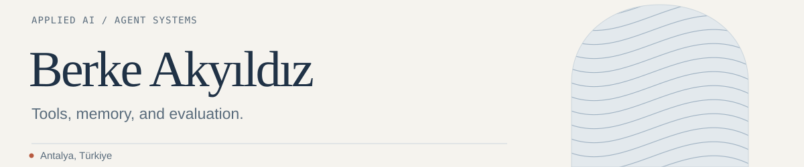

<picture>
  <source media="(prefers-color-scheme: dark) and (max-width: 600px)" srcset="assets/profile-header-dark-mobile.svg">
  <source media="(max-width: 600px)" srcset="assets/profile-header-light-mobile.svg">
  <source media="(prefers-color-scheme: dark)" srcset="assets/profile-header-dark.svg">
  
</picture>

I build AI agents and developer tools, mainly in Python. My work focuses on tool use, memory, and evaluations that check both an agent’s answer and its actions.

[Portfolio](https://brkakyldz.github.io/) · [LinkedIn](https://www.linkedin.com/in/berkeakyildiz/) · [Email](mailto:berkeakyildz@gmail.com)

### Selected work

**[Hotel Operations Agent](https://github.com/brkakyldz/Hotel_Operations_Agent)** 
An AI concierge for a simulated hotel, with business rules enforced in code and manager approval for restricted requests.

**[LLM Experiments](https://github.com/brkakyldz/llm-experiments)** 
Experiments on agent behavior, with saved traces, checks on tool use, and offline replay.

**[Second Brain OS](https://github.com/brkakyldz/second-brain-os)** 
Shared memory for coding agents, stored as readable Markdown and versioned with Git.

**[AI Digest](https://github.com/brkakyldz/ai-research-agent)** 
A local pipeline that collects AI news, removes duplicates, and produces a ranked daily briefing.

### Tools I use

Python, TypeScript, OpenAI Agents SDK, LangGraph, LangChain, FastAPI, and MCP.
