<picture>
  <source media="(max-width: 600px) and (prefers-color-scheme: dark)" srcset="assets/hero-dark-narrow.svg">
  <source media="(max-width: 600px)" srcset="assets/hero-light-narrow.svg">
  <source media="(prefers-color-scheme: dark)" srcset="assets/hero-dark.svg">
  
</picture>

I started building with AI to automate my own notes and research. Once I saw that a model could call tools and change things inside a system, I wanted to learn how to build that properly. Each project below puts an agent inside a small working system, such as a hotel's front desk, a support inbox or a salon's calendar, and then pays close attention to the places where it could go wrong: a write it shouldn't make, a request that needs a person's approval, or a reply that reads fine while the trace shows something else.

Before this I worked at the front desk of a hotel in Antalya, and that job shaped the hotel agent below. I work mostly in Python with the OpenAI Agents SDK, LangGraph and LangChain on top of the OpenAI and Anthropic APIs, and Claude Code and Codex are part of how I work every day.

## Projects

### [Hotel Operations Agent](https://github.com/brkakyldz/Hotel_Operations_Agent)

<a href="https://github.com/brkakyldz/Hotel_Operations_Agent"><picture><source media="(prefers-color-scheme: dark)" srcset="assets/glyph-hotel-dark.svg"></picture></a>

An AI concierge for a small fictional hotel, built on the OpenAI Agents SDK. Guests chat with it in any language and I play the manager. The hotel's rules for checkout, check-in and housekeeping run as code inside the database transaction, so the agent can file a late-checkout request but only a manager can approve it. When something changes at the hotel, code decides that the guest has to be told, and the agent writes the message.

**75 of 75** cases passed in the live eval, across 108 model runs, with no forbidden change to the database. 
`Python` · `OpenAI Agents SDK` · `FastAPI` · `SQLAlchemy` · `React` &nbsp;→&nbsp; [how it works](https://brkakyldz.github.io/isler/hotel-operations-agent/) (Turkish)

### [LLM Experiments](https://github.com/brkakyldz/llm-experiments)

<a href="https://github.com/brkakyldz/llm-experiments"><picture><source media="(prefers-color-scheme: dark)" srcset="assets/glyph-experiments-dark.svg"></picture></a>

Small experiments on how agents behave when they do real work. In the first one, *said-vs-did*, a support agent correctly refused a refund on someone else's order, but in the same reply it told the customer what was inside that order. An LLM judge that read only the reply gave it 7/10 and a pass, while a plain-code check over the trace flagged the leak. Every run is kept, and the saved traces can be re-scored offline without an API key.

**11 runs**, each graded three ways: a judge on the reply, and code checks on the outcome and on the order of tool calls. 
`Python` · `OpenAI and Anthropic APIs` · `LLM-as-judge` &nbsp;→&nbsp; [open the trace viewer](https://brkakyldz.github.io/llm-experiments/said-vs-did/trace-viewer.html)

### [AI Digest](https://github.com/brkakyldz/ai-research-agent)

<a href="https://github.com/brkakyldz/ai-research-agent"><picture><source media="(prefers-color-scheme: dark)" srcset="assets/glyph-digest-dark.svg"></picture></a>

A local LangGraph pipeline that reads the day's AI news for me. It polls RSS feeds every three hours, merges the same story told by different outlets, summarises and ranks what is left, and serves the day as a single page. Polling costs nothing, so it runs on a timer. The steps that call a model only run when I press the button, which keeps the bill around a dollar a month.

**About $1 a month** to run, on one machine and one container. 
`Python` · `LangGraph` · `FastAPI` · `HTMX` · `SQLite` &nbsp;→&nbsp; [how it works](https://brkakyldz.github.io/isler/ai-digest/) (Turkish)

### [Second Brain OS](https://github.com/brkakyldz/second-brain-os)

<a href="https://github.com/brkakyldz/second-brain-os"><picture><source media="(prefers-color-scheme: dark)" srcset="assets/glyph-brain-dark.svg"></picture></a>

A memory for coding agents that a person can read, correct and undo. Claude Code and Codex share one Obsidian vault that is also a Git repository. The facts that matter are loaded when a session starts, the rest is read when a question needs it, and every change the agent makes is a commit. This repo is the public template of the vault I have used every day since August.

**v1.1**, MIT licensed, runs on Windows, macOS and Linux with nothing to install beyond Node. 
`Markdown` · `Git` · `Node` · `Claude Code` · `Codex` · `Obsidian` &nbsp;→&nbsp; [how it works](https://brkakyldz.github.io/isler/second-brain-os/) (Turkish)

### [TechInves](https://github.com/brkakyldz/tech_inves)

<a href="https://github.com/brkakyldz/tech_inves"><picture><source media="(prefers-color-scheme: dark)" srcset="assets/glyph-techinves-dark.svg"></picture></a>

Scores US tech companies against their own peers and writes a research report on top. The score comes from deterministic code over SEC EDGAR filings and market data, with no model involved. A LangGraph pipeline researches the week and drafts the report, and a verifier made of rules and an LLM judge grades the draft before it is published, so a serious problem stops it.

**0 to 100** percentile scores across valuation, growth, quality and financial health, plus a separate risk score. 
`Python` · `LangGraph` · `FastAPI` · `SQLAlchemy` · `Next.js` &nbsp;→&nbsp; [how it works](https://brkakyldz.github.io/isler/techinves/) (Turkish)

### Smaller agents

Each of these applies one framework to one job, with a human approval step and a recorded acceptance run against the real model.

- **[GitHub Issue Triage Agent](https://github.com/brkakyldz/github-issue-triage-agent)** · Deep Agents · acceptance run 5 / 5 
  Labels new issues, finds duplicates and drafts replies, then shows the maintainer the whole batch on one review screen before anything is written to GitHub. Its work is visible in a [public sandbox](https://github.com/brkakyldz/issue-triage-sandbox/issues?q=is%3Aissue).
- **[Support Ticket Router](https://github.com/brkakyldz/support-ticket-router)** · LangGraph · acceptance run 6 / 6 
  Sends a store's support tickets to one of four teams. When the model is unsure, the graph pauses for a person and resumes on the same thread.
- **[Salon Booking Agent](https://github.com/brkakyldz/salon-booking-agent)** · LangChain · acceptance run 7 / 7 
  Books salon appointments in English or Turkish. Each booking waits for the owner's approval and is checked against opening hours and overlaps in one transaction.

## Tools I work with

- **Agents and models:** OpenAI Agents SDK, LangGraph, LangChain, Deep Agents, MCP, OpenAI and Anthropic APIs
- **Backend and data:** Python, TypeScript, FastAPI, SQLAlchemy, Pydantic, SQLite, PostgreSQL
- **Testing and tracing:** pytest, evals that check tool calls and database state, LangSmith
- **Every day:** Claude Code, Codex, Git, Docker, GitHub Actions, Obsidian

## Certificates

- **Anthropic, Claude Academy:** Building with the Claude API · Claude Code in Action · Introduction to Model Context Protocol · Model Context Protocol: Advanced Topics
- **LangChain, Foundation:** Introduction to LangGraph (Python) · Building Reliable Agents · Introduction to Deep Agents

 

I'd like to join a team that builds AI products people use every day. You can reach me by email or on LinkedIn, and my portfolio has a longer write-up of each project, in Turkish.

**[Portfolio](https://brkakyldz.github.io/)** &nbsp;·&nbsp; **[LinkedIn](https://www.linkedin.com/in/berkeakyildiz/)** &nbsp;·&nbsp; **[berkeakyildz@gmail.com](mailto:berkeakyildz@gmail.com)**
