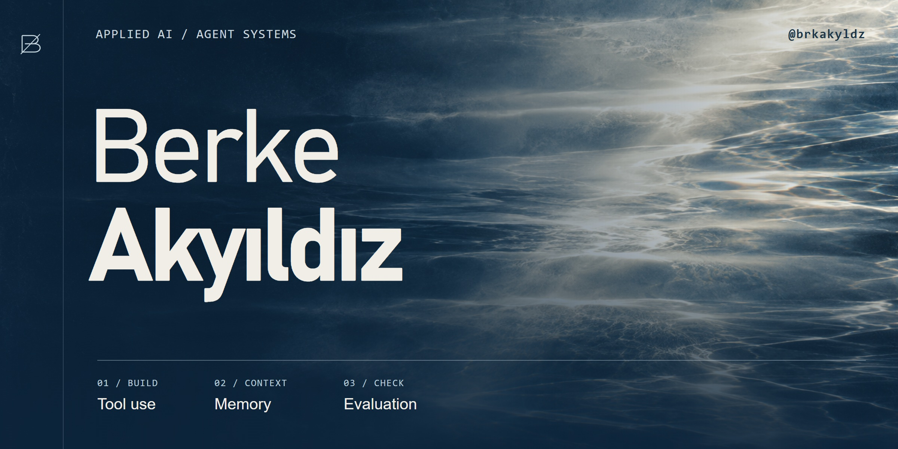
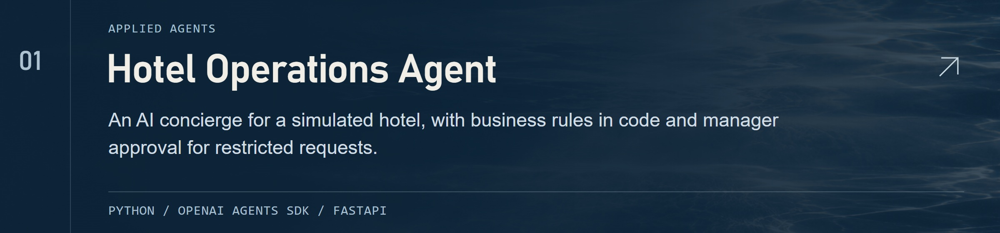
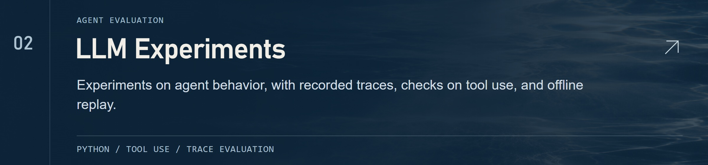
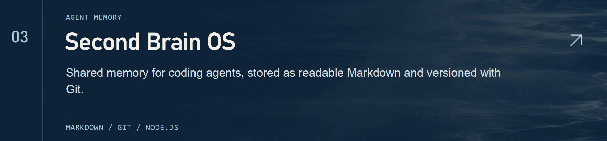
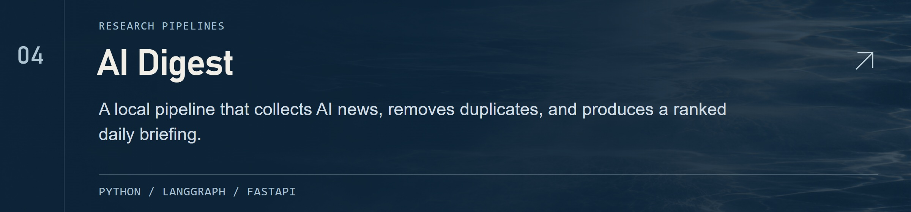
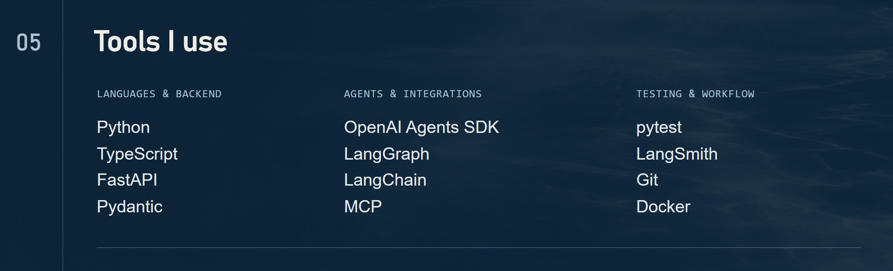

<picture>
  <source media="(max-width: 600px)" srcset="assets/profile/hero-mobile.jpg">
  
</picture>

I started building with AI to automate my own research and notes. I now build agents and developer tools, with a focus on tool use, memory, and evaluation.

[Portfolio ↗](https://brkakyldz.github.io/) · [LinkedIn ↗](https://www.linkedin.com/in/berkeakyildiz/) · [Email ↗](mailto:berkeakyildz@gmail.com)

### Selected work

<a href="https://github.com/brkakyldz/Hotel_Operations_Agent">
  <picture>
    <source media="(max-width: 600px)" srcset="assets/profile/hotel-mobile.jpg">
    
  </picture>
</a>
<a href="https://github.com/brkakyldz/llm-experiments">
  <picture>
    <source media="(max-width: 600px)" srcset="assets/profile/experiments-mobile.jpg">
    
  </picture>
</a>
<a href="https://github.com/brkakyldz/second-brain-os">
  <picture>
    <source media="(max-width: 600px)" srcset="assets/profile/brain-mobile.jpg">
    
  </picture>
</a>
<a href="https://github.com/brkakyldz/ai-research-agent">
  <picture>
    <source media="(max-width: 600px)" srcset="assets/profile/digest-mobile.jpg">
    
  </picture>
</a>

<picture>
  <source media="(max-width: 600px)" srcset="assets/profile/tools-mobile.jpg">
  
</picture>
